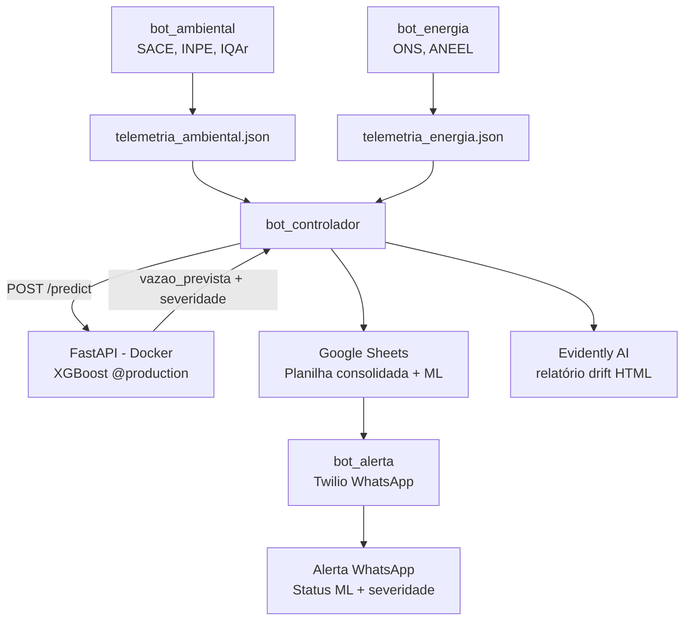
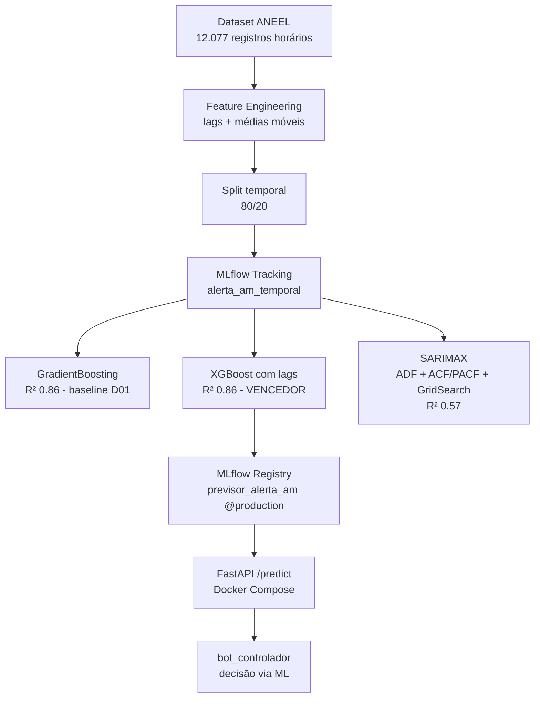
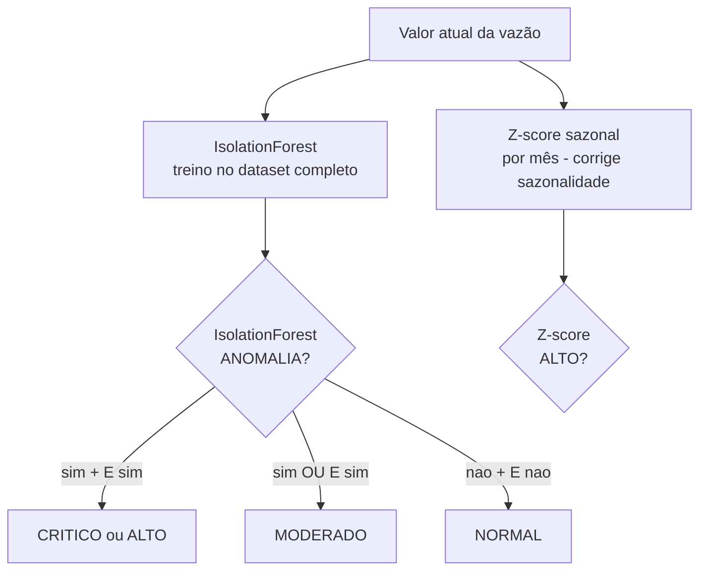

# Sistema de Alerta Energético e Ambiental do AM - ML BotCity

> **Propriedade Intelectual:** Este projeto e todo o seu código-fonte, modelos e artefatos são de propriedade da LG Electronics do Brasil Ltda., desenvolvido no âmbito do projeto AX Academy - Digital Transformation (Convênio N.º 005/2025 - INOVA / IFAM). Consulte o arquivo LICENSE para mais detalhes.

Evolução do Sistema de Alerta Energético e Ambiental do Amazonas, originalmente desenvolvido como RPA puro com BotCity (Desafio 01 - Módulo 1), agora upgradado com uma camada completa de Machine Learning (Desafio 02 - Data Science / ML). O sistema deixa de tomar decisões por regras hardcoded (if/else) e passa a tomar decisões informadas por um modelo de ML carregado do MLflow Registry, servido via FastAPI e monitorado por Evidently AI.

---

## Problema

O Amazonas enfrenta desafios ambientais e energéticos críticos: variações no nível do Rio Negro, focos de incêndio, qualidade do ar e a capacidade de geração da UHE Balbina impactam diretamente a população e a tarifa de energia. O sistema monitora continuamente esses indicadores e dispara alertas inteligentes via WhatsApp com base em predições de Machine Learning.

- Tipo de problema: Regressão temporal + Detecção de anomalia
- Variável-alvo: `val_vazaodefluente` (m³/s) - UHE Balbina
- Modelo em produção: XGBoost com features de lag (R² = 0.86)
- Detector de anomalia: IsolationForest + Z-score sazonal (abordagem híbrida)

---

## Arquitetura

### Fluxo completo do sistema



### Pipeline de ML



### Detector de anomalia híbrido



---

## Evolução: RPA para APA

| Aspecto | Módulo 1 - RPA | Desafio 02 - ML |
|---|---|---|
| Decisão | if/else hardcoded | predição XGBoost @production |
| Status | regras fixas | severidade ML (NORMAL/MODERADO/ALTO/CRITICO) |
| Alerta | baseado em limiares | baseado em anomalia híbrida |
| Monitoramento | nenhum | Evidently AI - drift detection |
| Vazão Balbina | volume útil (%) | volume (%) + vazão m³/s |

---

## Comparativo dos modelos

### Desafio 01 - Baseline (Balbina Hydro MLOps)

| Modelo | RMSE CV | R² CV | RMSE Teste | R² Teste |
|---|---|---|---|---|
| LinearRegression | 107.74 | 0.817 | 182.34 | 0.764 |
| RandomForestRegressor | 90.05 | 0.893 | 162.98 | 0.812 |
| **GradientBoostingRegressor** | **83.26** | **0.904** | **160.96** | **0.816** |

### Desafio 02 - Com features de lag e sazonalidade

| Modelo | MAE | RMSE | R² | Observação |
|---|---|---|---|---|
| GradientBoosting | 79.78 | 140.66 | 0.8592 | baseline do D01, referência |
| **XGBoost com lags** | **76.50** | **137.96** | **0.8646** | **vencedor - @production** |
| SARIMAX (1,1,1)(1,1,1,24) | 188.49 | 234.76 | 0.5713 | ADF + ACF/PACF + GridSearch s=24 |

O SARIMAX foi estudado com metodologia completa conforme recomendação do professor:
- Teste ADF: série não estacionária (p=0.13), d=1
- ACF/PACF: indicaram p=1, q=1
- GridSearch: sazonalidade diária s=12 e horária s=24
- Melhor resultado com 2000 pontos horários e s=24 (R²=0.57)
- Com 3+ anos de histórico teria vantagem sobre o XGBoost

---

## Estrutura do projeto

```
Sistema-Alerta-AM-ML-BotCity/
├── bot_ambiental/
│   ├── bot.py
│   └── requirements.txt
├── bot_energia/
│   ├── bot.py
│   └── requirements.txt
├── bot_controlador/
│   ├── bot.py
│   ├── requirements.txt
│   ├── relatorio_drift.html
│   └── config/
│       ├── oauth_credentials.json
│       └── token_sheets.json
├── bot_alerta/
│   ├── bot.py
│   ├── requirements.txt
│   └── config/
│       ├── oauth_credentials.json
│       └── token_sheets.json
├── ml/
│   ├── notebooks/
│   │   ├── 01_eda.ipynb
│   │   ├── 01_eda.pdf
│   │   ├── 02_modelagem.ipynb
│   │   ├── 02_modelagem.pdf
│   │   └── 03_anomalia_temporal.ipynb
│   ├── src/
│   │   ├── api.py
│   │   ├── promover.py
│   │   └── treino.py
│   ├── data/
│   │   ├── processed/balbina_processado.csv.dvc
│   │   └── raw/balbina_consolidado.csv.dvc
│   ├── screenshoots/d02/
│   ├── mlruns/
│   ├── Dockerfile
│   ├── docker-compose.yml
│   ├── requirements.txt
│   └── requirements-api.txt
├── LICENSE
├── REPOSITORIO.md
├── README.md
└── .gitignore
```

---

## Dataset

Os dados foram coletados do portal de dados abertos da ANEEL:
https://dadosabertos.aneel.gov.br

- Período: janeiro/2025 a maio/2026 (17 meses, dados horários)
- Total após limpeza: 12.077 registros
- Variável-alvo: `val_vazaodefluente` (m³/s)
- Fonte: UHE Balbina - rio Uatumã, Amazonas

**Origem:** `https://dados.ons.org.br/dataset/dados_hidrologicos_ho`
**Data de download:** janeiro/2026
**Licença:** Dados Abertos - Portal ONS/ANEEL

---

## Pré-requisitos

- Python 3.11+
- Docker Desktop
- Git e DVC
- Google Chrome instalado
- Conta ativa no BotCity Maestro
- Conta Twilio com WhatsApp Sandbox configurado
- Projeto Google Cloud com Google Sheets API habilitada

---

## Como reproduzir

### 1. Clonar o repositório

```bash
git clone https://github.com/vbrenox/Sistema-Alerta-AM-ML-BotCity.git
cd Sistema-Alerta-AM-ML-BotCity
```

### 2. Ambiente virtual

```bash
python -m venv venv
venv\Scripts\activate
```

### 3. Instalar dependências

```bash
pip install -r bot_ambiental/requirements.txt
pip install -r bot_energia/requirements.txt
pip install -r bot_controlador/requirements.txt
pip install -r bot_alerta/requirements.txt
pip install -r ml/requirements.txt
```

### 4. Recuperar datasets via DVC

```bash
cd ml
dvc pull
```

O remote local está configurado em `C:/dvcstore`.

### 5. Treinar os modelos (opcional - mlruns já incluído)

```bash
jupyter notebook
```

Execute os notebooks em ordem:
- `ml/notebooks/01_eda.ipynb` - análise exploratória
- `ml/notebooks/02_modelagem.ipynb` - pipeline Desafio 01
- `ml/notebooks/03_anomalia_temporal.ipynb` - modelos + anomalia Desafio 02

### 6. Subir a FastAPI via Docker

```bash
cd ml
docker compose up --build
```

Acesse: `http://localhost:8000/docs`

### 7. Executar os bots em sequência

```bash
python bot_ambiental/bot.py
python bot_energia/bot.py
python bot_controlador/bot.py
python bot_alerta/bot.py
```

---

## Configuração de credenciais

### Arquivo `.env`

```env
TWILIO_SID=ACxxxxxxxxxxxxxxxxxxxxxxxxxxxxxxxx
TWILIO_TOKEN=xxxxxxxxxxxxxxxxxxxxxxxxxxxxxxxx
TWILIO_FROM=+14155238886
TWILIO_TO=+5592XXXXXXXXX
```

### Google Sheets - OAuth2

1. Acesse o Google Cloud Console
2. Crie um projeto e habilite a Google Sheets API
3. Crie credencial OAuth 2.0 do tipo Aplicativo de desktop
4. Salve como `bot_controlador/config/oauth_credentials.json` e `bot_alerta/config/oauth_credentials.json`
5. Na primeira execução o navegador abrirá para autorização - o token é salvo automaticamente

### ID da planilha

```python
SHEET_ID = "1wG6icQpwUmfjaL0KruwXelH9iAKV_UfRjwOURZXJDqE"
```

---

## Configuração no BotCity Maestro

### Deploy dos bots

| Bot | Label no Maestro |
|---|---|
| `bot_ambiental` | `victorbreno-ambiental-v1` |
| `bot_energia` | `victorbreno-energia-v1` |
| `bot_controlador` | `victorbreno-controlador-v1` |
| `bot_alerta` | `victorbreno-alerta-v1` |

### Credentials Vault

Label: `victorbreno-twilio-v1`

| Chave | Valor |
|---|---|
| `TWILIO_SID` | Account SID da Twilio |
| `TWILIO_TOKEN` | Auth Token da Twilio |
| `TWILIO_FROM` | Número Twilio |
| `TWILIO_TO` | Número destino |

---

## Monitoramento de drift - Evidently AI

Ao final de cada execução o `bot_controlador` gera o arquivo `relatorio_drift.html` comparando o dado atual coletado pelo bot com o baseline de treino (dataset histórico da Balbina). O relatório usa `DataDriftPreset` com distância de Wasserstein para detectar desvios na distribuição da vazão defluente.

---

## Decisões técnicas

- XGBoost com features de lag supera GradientBoosting do D01 com dataset aumentado (lag_1h, lag_6h, lag_24h, lag_168h, media_6h, media_24h)
- SARIMAX estudado com metodologia completa (ADF, ACF/PACF, GridSearch) mas limitado pelo histórico de 17 meses
- Detector híbrido (IsolationForest + Z-score sazonal) resolve o problema de falsos positivos na época de cheia
- MLflow file store com `MLFLOW_ALLOW_FILE_STORE=true` para compatibilidade com MLflow 3.x
- FastAPI carrega modelo via glob no diretório mlruns (workaround para alias resolution do MLflow 3.x com file store)

---

## Limitações e próximos passos

- SARIMAX com 3+ anos de histórico teria vantagem sobre XGBoost para sazonalidade anual
- Lags calculados com aproximação do valor atual (bot roda poucas vezes por dia, não horariamente)
- LSTM recomendada pelo professor Anderson como evolução natural do projeto

---

## Tecnologias utilizadas

- Python 3.11
- BotCity Framework Web + BotCity Maestro SDK
- XGBoost, scikit-learn, statsmodels (SARIMAX)
- MLflow 3.x - rastreamento e Model Registry
- FastAPI + uvicorn
- Docker Compose
- Evidently AI - drift detection
- DVC - versionamento de datasets
- Google Sheets API - botcity-googlesheets-plugin
- Twilio WhatsApp - botcity-twilio-whatsapp-plugin

---

## Autor

**Victor Breno Carvalho da Silva**
Bolsista de P&DI - IFAM
Projeto: AX Academy - Digital Transformation
Disciplina: Data Science, Machine Learning e Data Mining
Professor: Eduardo Palhares
Mentor: Anderson Gadelha 
